# Kynetra Master Project Evolution & Upgrade Matrix

> **Authoritative Engineering Roadmap & Gap Analysis**  
> **Repository:** `akshaykumar33/kynetra`  
> **Status:** Phase 00 (Foundation) Complete → Transitioning to Phase 01 (Platform Core)  
> **Governing Standards:** [AGENTS.md](./AGENTS.md) | [Architecture Docs](./docs/02-architecture/) | [ADRs](./docs/08-decisions/)

---

## 1. Executive Summary & Current Architecture Baseline

Kynetra is architected as a **modular monolith** with a unified domain state platform designed to power multiple client lenses (2D web console, 3D WebGL/WebGPU viewport, mobile, and XR). 

| Metric / Aspect | Current Baseline (Phase 00) | Target State (Production Platform) |
|---|---|---|
| **Repository Tooling** | Turborepo 2.4, pnpm 10.33, TypeScript 5.7.3 strict | Multi-language monorepo (TS, Go, Rust, Python) |
| **Frontend Shell (`apps/web`)** | Next.js 15.2 (Single-page 2D mock HUD, duplicated mock data) | Next.js 15 App Router + React Three Fiber 3D canvas + Xterm.js terminal + WebRTC |
| **Backend API (`services/api`)** | Fastify 5.2 (In-memory mock data, basic health/world routes) | Fastify modular monolith + PostgreSQL 16 (pgvector) + Redis 7 pub/sub + OpenTelemetry |
| **Realtime Service** | None (Static polling / client state) | Go Realtime Gateway (`services/realtime`) with WebSockets & AOI spatial sync (Phase 03) |
| **Simulation Core** | Mock string alerts | Rust Simulation Engine (`services/simulation`) with procedural chaos & container labs (Phase 06) |
| **AI Intelligence** | Static NPC node label | Centralized AI Gateway (`services/ai-gateway`) with LLM routing, memory, RAG, safety (Phase 07) |
| **Shared Contracts** | 4 schemas (`world.ts`, `user.ts`, `telemetry.ts`, `health.ts`) | Complete Zod contracts for Orgs, RBAC, Realtime Packets, Quests, Telemetry, and MQTT |
| **Infrastructure** | Local Docker Compose (Postgres, Redis, Jaeger) | Local Dev → AWS ECS Fargate (Phases 01–09) → AWS EKS Planetary Scale (Phase 10) |

---

## 2. Master Phased Evolution Matrix (Phase 00 to Phase 10)

This master table defines what must be built, updated, and verified across all 11 phases of Kynetra's roadmap.

| Phase | Phase Name | Status | Key UI Updates (`apps/web`) | Key Backend Updates (`services/*`) | Contract & Schema Updates (`packages/contracts`) | DevOps & Tooling Updates | Exit Criteria (Definition of Done) |
|---|---|---|---|---|---|---|---|
| **00** | **Foundation** | **Complete** | - 2D District visualizer - Innovation Tower Floor deck - Mock interactive node cards - Diagnostics status strip | - Fastify server skeleton - `/health/live` & `/health/ready` - `/api/v1/telemetry` - In-memory district catalog | - `WorldDistrictSchema` - `InnovationTowerFloorSchema` - `UserProfileSchema` - `SystemHealthMetricSchema` | - Turborepo pipeline - Docker compose (PG, Redis, Jaeger) - GitHub Actions CI workflow | Clean CI run: lint, typecheck, and unit tests pass; health endpoint returns 200 OK. |
| **01** | **Platform Core** | **Up Next** | - Multi-tenant Org switcher - Campus & building navigator - Interactive floorplan SVG/Canvas - Auth login/register modal & session HUD - Dynamic API data fetcher | - PostgreSQL 16 connection pool (Drizzle or Prisma ORM) - Database migrations engine - Redis session store & rate limiting - OAuth2/OIDC + JWT auth middleware - Tenant & RBAC permission guards | - `OrganizationSchema` - `TenantMembershipSchema` - `BuildingFloorPlanSchema` - `AuthSessionSchema` - `RbacPermissionSchema` | - Database migration runner in CI - Testcontainers for Postgres/Redis in integration tests - Seed data scripts for districts & orgs | Users authenticate, switch organizations, browse real database-backed campus floorplans with strict RBAC enforcement. |
| **02** | **First 3D World** | **Planned** | - React Three Fiber canvas viewport - Central Plaza 3D environment - Innovation Tower exterior & lobby - Third-person avatar controller - Camera zoom into workstations - 2D ↔ 3D toggle switch | - 3D asset metadata serving API - GLTF/GLB model streaming & CDN caching headers - User spawn coordinate service - Static mesh collision validation | - `Vector3DSchema` & `QuaternionSchema` - `AvatarCustomizationSchema` - `ViewportTransitionStateSchema` - `SpatialAssetManifestSchema` | - 3D asset compression pipeline (Draco, KTX2) - S3/CloudFront bucket configuration for 3D assets | Users spawn in 3D Central Plaza, navigate with WASD/mouse at 60 FPS, and smoothly transition between 2D console and 3D viewport. |
| **03** | **Multiplayer** | **Planned** | - Remote player avatars with nameplates - Proximity voice/audio indicators - Local player movement interpolation - In-viewport quick-chat bubbles - Latency & packet jitter HUD | - **New Service:** `services/realtime` (Go Gateway per ADR-0008) - WebSocket connection manager - Spatial Area-of-Interest (AOI) grid - 20 Hz movement tick delta compression - Redis pub/sub backplane | - `PlayerMovementPacketSchema` - `PresenceHeartbeatPacketSchema` - `SpatialAudioEnvelopeSchema` - `ChatBroadcastPacketSchema` | - Go build toolchain integration in Turborepo - WebSocket load test suites (k6 / Locust) - Multi-instance Redis pub/sub cluster setup | 1,000 concurrent connected avatars moving in Central Plaza with client tick interpolation and <50ms server tick latency. |
| **04** | **Social System** | **Planned** | - Multi-channel chat drawer (District, Org, Floor, DM) - Persistent friend lists & status - Virtual conference room HUD - Embedded WebRTC video & screen share - Whiteboard canvas with multi-cursor | - WebRTC signaling server (SFU integration e.g. LiveKit) - Chat history persistence in PostgreSQL - Channel membership & notification manager - Screen share bandwidth throttling | - `ChatMessageSchema` - `SocialRelationshipSchema` - `WebRtcSignalPacketSchema` - `CollaborationCanvasEventSchema` | - STUN/TURN server deployment - S3 storage for chat attachments and exported whiteboards | Engineering teams can hold a real standup in an Innovation Tower conference room with video, audio, screen share, and synchronized whiteboard. |
| **05** | **Gamification** | **Planned** | - Interactive developer skill tree UI - Verifiable badge showcase modal - District & global leaderboards - Quest log & active challenge tracker - Level-up celebration micro-animations | - Verified XP calculation engine - Cryptographic achievement minting (ECDSA signed tokens) - Leaderboard ranking aggregation worker in Redis - Challenge validation webhook consumer | - `SkillTreeNodeSchema` - `BadgeDefinitionSchema` - `CryptographicProofSchema` - `LeaderboardEntrySchema` - `QuestProgressSchema` | - Background job scheduler for nightly leaderboard re-indexing - Vault/KMS key management for badge signing | Completing code challenges automatically awards verified XP, signs cryptographic skill badges, and updates real-time leaderboards. |
| **06** | **Work & Simulation** | **Planned** | - In-browser IDE / Terminal (Xterm.js) - Live incident response dashboard - Real-time log streamer & metric graphs - Chaos injection trigger controls - Code review & diff inspection view | - **New Service:** `services/simulation` (Rust core per ADR-0009) - Ephemeral Docker sandbox container runner - Procedural chaos injector (latency, packet drop, process kill) - Automated grading & test evaluation harness | - `SimulationScenarioSchema` - `SandboxSessionSchema` - `ChaosInjectionRuleSchema` - `EvaluationResultSchema` - `TerminalStreamChunkSchema` | - Isolated Docker-in-Docker or Firecracker microVM execution environment - Resource limits (cgroups) and network sandbox isolation | Developers open a workstation terminal, face a simulated live production outage, isolate root cause, submit a patch, and pass automated CI grading. |
| **07** | **AI World Platform** | **Planned** | - Aria Receptionist conversational modal (voice & text) - Autonomous AI Mentor floating dialogue - Technical Mock Interviewer HUD - In-world AI guidance markers & pathfinding | - **New Service:** `services/ai-gateway` (Fastify / Python per ADR-0010) - Pluggable LLM provider adapter (Gemini, Claude, GPT) - RAG pipeline over Kynetra technical docs via `pgvector` - Agent tool permission sandboxing | - `AgentPersonalitySchema` - `AiDialogueStreamChunkSchema` - `RAGRetrievalQuerySchema` - `AgentToolExecutionRequestSchema` | - Token rate limiter and cost governance monitor - Prompt evaluation and safety guardrail suite (`docs/05-ai/ai-safety.md`) | Users interact with Aria Receptionist and AI Mentors who answer technical questions, run in-world commands, and conduct simulated technical interviews. |
| **08** | **Digital Twin** | **Planned** | - 3D heatmap overlays on buildings - Live IoT sensor nodes in rooms - Power & server rack energy graphs - Physical vs virtual occupancy gauges | - MQTT broker ingestion worker (EMQX / Mosquitto bridge) - Time-series telemetry processor - Building management system (BMS) connectors - Anomaly detection trigger service | - `MqttSensorReadingSchema` - `BuildingTelemetryAggregateSchema` - `RackPowerMetricSchema` - `OccupancySensorSchema` | - Time-series database integration (TimescaleDB extension on Postgres) - MQTT broker container in docker-compose | Live telemetry from physical hardware/facilities streams into Kynetra, dynamically tinting 3D room heatmaps and workstation status in real-time. |
| **09** | **XR & Spatial** | **Planned** | - WebXR immersive mode button - Spatial 3D UI panels & curved HUDs - Hand-tracking gestures (pinch-to-interact) - Spatial audio listener calibration | - WebXR session state handshake - High-precision spatial matrix synchronization - Low-latency positional audio routing | - `SpatialAnchorSchema` - `HandTrackingPoseSchema` - `XrDeviceCapabilitiesSchema` | - WebXR emulator testing profiles - Headset compatibility matrix validation (Meta Quest, Vision Pro, etc.) | Developers put on a VR/AR headset, navigate Kynetra Central in immersive 3D, and manipulate holographic terminal panels using natural hand gestures. |
| **10** | **Planetary Scale** | **Planned** | - Global world map & shard selector - Seamless cross-shard zone transitions - Disaster recovery status indicator | - Spatial world partitioning (octree/quadtree sharding) - Multi-region active-active database replication - Distributed consensus for cross-shard transfers - Automated chaos testing in production | - `WorldShardManifestSchema` - `CrossShardMigrationPacketSchema` - `GlobalPartitionStateSchema` | - Migration from AWS ECS to AWS EKS (Kubernetes) - Multi-region AWS deployment with Route 53 latency routing | 100,000+ concurrent developers across global shards with seamless border transitions, zero-downtime rolling upgrades, and automated disaster failover. |

---

## 3. UI / Frontend Updates Detailed Table (`apps/web`)

Detailed breakdown of current gaps, required component implementations, and architectural changes in `apps/web`.

| UI Surface / Component | Current Implementation (Baseline) | Things to Update / Implement | Tech Stack / Libraries | Phase | Priority |
|---|---|---|---|---|---|
| **Data Fetching Layer** | Hardcoded static `DISTRICTS_DATA` in `page.tsx` | Replace hardcoded array with TanStack React Query hooks calling `services/api` endpoints (`/api/v1/world/districts`, `/api/v1/telemetry`). Handle loading skeletons, error states, and background refetching. | TanStack Query v5, `@kynetra/contracts`, Fetch API | Phase 01 | **P0 (Blocker)** |
| **Application Routing & Layout** | Single monolithic `page.tsx` file (441 lines) | Refactor into Next.js 15 App Router routes: - `/` (World Overview) - `/districts/[id]` (District Explorer) - `/floors/[floorId]` (Floorplan View) - `/workstations/[nodeId]` (Node/Workstation View) - `/arena` (Coding Arena) - `/orgs` (Organizations & Companies) - `/profile` (User Profile & Badges) | Next.js 15 App Router (`app/` directory) | Phase 01 | **P0 (Blocker)** |
| **Authentication & Profile HUD** | None (Guest role hardcoded in types) | Add top-right navigation bar with user avatar, level badge, online status dropdown, and OAuth login/register modal dialog. Add route guard for protected floors. | Lucide Icons, Custom Design Tokens, CSS Modules / Vanilla CSS | Phase 01 | **P0 (Blocker)** |
| **Organization & Campus Selector** | None | Add Organization switcher dropdown allowing multi-tenant switching between public spaces, university campuses, and private enterprise buildings. | React Context / Zustand, Contracts | Phase 01 | **P1** |
| **Interactive 2D Floorplan Canvas** | Simple CSS cards list for nodes | Build an interactive SVG/HTML5 canvas floorplan viewer displaying real-time node coordinates, user occupancy dots, and interactive hover tooltips. | SVG / HTML5 Canvas / React PanZoom | Phase 01 | **P1** |
| **3D Viewport Integration** | Static text "Spatial Construction in Progress" | Embed `<Canvas>` using React Three Fiber with WebGPU / WebGL fallback. Render 3D terrain, procedural district architecture, dynamic daylight skybox, and camera rig. | Three.js, `@react-three/fiber`, `@react-three/drei` | Phase 02 | **P0** |
| **Avatar Controller & Navigation** | None | 3D third-person character controller with WASD/arrow key walking, jump, sprint, mouse-look rotation, and collision detection against building boundaries. | R3F, Rapier Physics (`@react-three/rapier`) | Phase 02 | **P1** |
| **Workstation Zoom & Docking** | Simulates action with a temporary banner | Clicking an interactive terminal smoothly moves the 3D camera to frame the computer monitor and docks an interactive overlay into the screen texture or DOM HUD. | GSAP / Three.js camera lerp | Phase 02 | **P1** |
| **Realtime Movement Interpolation** | None | Render other connected players in 3D scene using dead reckoning and lerp smoothing for position/rotation updates received via WebSocket. | Three.js, WebSocket client | Phase 03 | **P0** |
| **Proximity Chat & Nameplates** | None | Floating 3D billboard nameplates over player avatars with typing indicators, speech bubbles, and volume level rings for spatial audio. | `@react-three/drei` Html/Billboard, Web Audio API | Phase 03 | **P1** |
| **In-Browser Terminal Console** | Simulated click alert notice | Embed fully functioning terminal emulator connected to real container sandbox via WebSocket. Support ANSI colors, tab completion, and copy-paste. | `xterm.js`, `xterm-addon-fit`, `xterm-addon-web-links` | Phase 06 | **P0** |
| **Collaborative Whiteboard** | None (Static node type only) | Vector drawing canvas supporting freehand pen, sticky notes, architecture shapes, multi-user real-time cursors, and PNG/SVG export. | HTML5 Canvas / tldraw / Fabric.js | Phase 04 | **P1** |
| **AI Receptionist Dialogue Modal** | None (Static description only) | Interactive speech & text dialogue modal for Aria Receptionist with streaming text response, synthetic audio playback, and clickable action suggestions. | Web Speech API / ElevenLabs, Server-Sent Events | Phase 07 | **P1** |
| **Design System & Accessibility** | Custom CSS classes in `globals.css` | Comprehensive design token audit: high contrast WCAG 2.1 AA compliance, ARIA keyboard navigation for screen readers, focus-visible outlines, responsive mobile drawer. | Vanilla CSS Tokens, CSS Variables | Continuous | **P1** |

---

## 4. Backend Logic & Micro-Engines Updates Table (`services/*`)

Detailed breakdown of current gaps, required endpoints, database models, and service additions across the backend architecture.

| Service / Subsystem | Current Implementation (Baseline) | Things to Update / Implement | Tech Stack / Architecture | Phase | Priority |
|---|---|---|---|---|---|
| **Database & Persistence (`services/api`)** | Pure in-memory mock array (`mock-world.ts`) | Setup PostgreSQL 16 connection pool using **Drizzle ORM** or **Prisma**. Create tables for `tenants`, `organizations`, `districts`, `buildings`, `floors`, `interactive_nodes`, and `users`. Implement transaction-safe repositories. | PostgreSQL 16, pgvector, Drizzle ORM | Phase 01 | **P0 (Blocker)** |
| **Database Migrations & Seeding** | None | Implement automated, version-controlled SQL migration scripts. Create a database seeder script populating initial districts, Innovation Tower floors, and sample interactive nodes. | Drizzle Kit / Node-pg-migrate | Phase 01 | **P0 (Blocker)** |
| **Caching & Rate Limiting (`services/api`)** | None | Connect to Redis 7. Implement cache-aside for district and floor metadata. Add token bucket rate limiter to prevent abuse on public API endpoints. | Redis 7, `ioredis`, `@fastify/rate-limit` | Phase 01 | **P1** |
| **Authentication & RBAC (`services/api`)** | None (No auth headers or session checks) | Implement OAuth2/OIDC integration (GitHub & Google login) and JWT issuing/verification. Add Fastify pre-handler hook enforcing RBAC roles (`guest`, `developer`, `mentor`, `tech_lead`, `sre_engineer`, `admin`). | `@fastify/jwt`, `@fastify/cookie`, Zod | Phase 01 | **P0 (Blocker)** |
| **Multi-Tenancy Isolation (`services/api`)** | None | Implement tenant context injection via request headers/subdomain. Scope building layouts, private workspaces, and room access by `tenant_id`. | Fastify hook, PostgreSQL Row-Level Security (RLS) | Phase 01 | **P1** |
| **Realtime Gateway Service (`services/realtime`)** | None | **Create new service** in Go per ADR-0008. Implement high-throughput WebSocket server handling client handshakes, presence heartbeats, 20 Hz movement delta broadcasting, and Redis pub/sub room clustering. | Go 1.22, Gorilla WebSocket / nhooyr, Redis client | Phase 03 | **P0** |
| **WebRTC Signaling & Social (`services/api` / realtime)** | None | Implement WebRTC signaling protocol (offer, answer, ICE candidates) for team standup rooms, 1-on-1 audio calls, and screen sharing. Integrate SFU for multi-party audio. | WebSockets, LiveKit / Pion WebRTC | Phase 04 | **P1** |
| **Gamification & XP Engine (`services/api`)** | Hardcoded XP numbers in contract | Implement event-driven XP granting pipeline. Deduplicate XP events via Redis idempotent keys. Generate ECDSA digital signatures for verified skill badge proofs. | Node.js crypto, PostgreSQL, Redis | Phase 05 | **P1** |
| **Simulation Core Service (`services/simulation`)** | None | **Create new service** in Rust per ADR-0009. Implement high-performance physics simulation, incident state machines, procedural network chaos injection, and container lifecycle manager. | Rust, Tokio, Docker API / containerd | Phase 06 | **P0** |
| **Sandbox Container Runner** | None | Spawns isolated Docker containers or Firecracker microVMs for user coding pods. Exposes pseudo-terminal (PTY) stream over WebSocket to the web terminal. | Node-pty / Dockerode / Rust containerd | Phase 06 | **P0** |
| **Centralized AI Gateway (`services/ai-gateway`)** | None | **Create new service** per ADR-0010. Implement unified abstraction over Gemini, Anthropic, and OpenAI. Add tool execution sandbox, token budget limiter, and vector similarity retrieval via `pgvector`. | TypeScript / Fastify or Python FastAPI, `pgvector` | Phase 07 | **P0** |
| **Digital Twin Telemetry Bridge** | None | Implement MQTT ingestion worker connecting to building sensors. Normalize readings into time-series records and broadcast threshold alerts to the 3D world engine. | MQTT.js / Eclipse Paho, TimescaleDB / Postgres | Phase 08 | **P1** |
| **Observability & Telemetry** | Basic mock telemetry endpoint (`/api/v1/telemetry`) | Instrument all services with OpenTelemetry SDK per ADR-0012. Auto-instrument HTTP requests, database queries, and Redis calls. Export traces to Jaeger (port 4318) and metrics to Prometheus. | `@opentelemetry/sdk-node`, Jaeger OTLP exporter | Phase 01 | **P1** |

---

## 5. Domain Features & Functional Capabilities Update Table

Detailed breakdown of end-user features that must be designed, implemented, and verified.

| Feature Area | Target Phase | Feature Scope & Detailed Requirements | UI Entry Points | Backend APIs & Events | Acceptance Criteria |
|---|---|---|---|---|---|
| **Campus & Spatial Navigation** | Phase 01 | - Hierarchical hierarchy: District → Building → Floor → Room. - Public zones vs private tenant buildings. - Fast travel warp portals between districts. | District selector sidebar, floor tabs, fast travel map | `GET /api/v1/districts` `GET /api/v1/districts/:id/buildings` `GET /api/v1/buildings/:id/floors` | Selecting any district immediately loads associated buildings and floors with live occupancy counters. |
| **User Identity & Progression Profile** | Phase 01 | - User profile view with custom avatar, handle, role, and discipline. - Experience points (XP) breakdown by discipline (Dev, SRE, AI). - Public profile permalink. | User drawer, profile page (`/profile/[handle]`) | `GET /api/v1/users/me` `PATCH /api/v1/users/me` `GET /api/v1/users/:handle` | Authenticated users can edit their profile, view earned badges, and inspect their skill progression. |
| **3D Central Plaza Exploration** | Phase 02 | - Rich 3D environment representing Kynetra Central. - Architectural structures (Innovation Tower, Civic Stage). - Dynamic day/night ambient lighting and directional shadows. - Smooth 60 FPS performance on standard laptops. | Toggle button "Enter 3D World", Fullscreen canvas | `GET /api/v1/world/assets/manifest` `GET /api/v1/world/spawn-points` | Users explore Central Plaza with zero stuttering, draw calls < 50, and smooth camera controls. |
| **Algorithmic Coding Arena** | Phase 02–05 | - Dual-terminal battle pods for algorithmic duels. - Automated test evaluation against predefined test cases. - Live spectator leaderboard and code diff replay. | Arena floor (`/arena`), battle pod terminal modal | `POST /api/v1/arena/matches/join` `POST /api/v1/arena/matches/:id/submit` `EVENT arena.match.evaluated` | Two developers enter a battle pod, submit code, tests run in sandbox, and winner is awarded XP automatically. |
| **SRE Incident Response Lab** | Phase 06 | - Simulated cloud infrastructure running inside sandboxed containers. - Chaos engineering scenarios (network latency, crash loops, DB connection starvation). - NOC terminal with real metrics, logs, and trace viewers. - Automated verification of hotfix patches. | SRE Lab Floor 8 (`/labs/sre`), NOC Terminal modal | `POST /api/v1/simulations/start` `POST /api/v1/simulations/:id/inject-fault` `POST /api/v1/simulations/:id/submit-fix` | Developer triggers outage scenario, identifies root cause using logs, applies fix, and system marks incident as RESOLVED. |
| **AI Concierge & Mentors** | Phase 07 | - Aria Receptionist greeting new developers at Floor 1 Lobby. - Context-aware technical mentors answering questions about code and architecture. - Autonomous AI mock interviewer conducting coding and system design interviews. | Dialogue modal, NPC interaction trigger button | `POST /api/v1/ai/chat` `POST /api/v1/ai/interview/start` `STREAM /api/v1/ai/stream` | Aria accurately answers questions about Kynetra navigation, guides user to appropriate floor, and remembers conversation context. |
| **Virtual Team Standup Rooms** | Phase 04 | - Private engineering meeting rooms with door locks. - Spatial audio within room boundaries. - WebRTC multi-party video conferencing and screen share. - Collaborative architecture diagramming board. | Meeting room portals (`/rooms/:id`), Room control bar | `POST /api/v1/rooms/join` `POST /api/v1/rooms/:id/lock` `WS /realtime/rooms/:id` | Team members enter room, hear each other's audio, share screen without lag, and external players cannot overhear private audio. |
| **Cryptographic Skill Badges** | Phase 05 | - Cryptographically signed achievement credentials. - Verifiable on external platforms or exportable as SVG/JSON-LD. - Linked to specific commit hashes and test pass logs. | Profile badge showcase, badge verify modal | `GET /api/v1/badges/:id/verify` `POST /api/v1/badges/claim` | Anyone can verify a developer's badge authenticity using Kynetra's public key without logging into the platform. |
| **Physical Building Digital Twin** | Phase 08 | - Live heatmaps showing physical building power, temperature, and occupancy. - Interactive 3D sensor markers displaying real-time readings. - Visual alerts when physical equipment exceeds operational thresholds. | Digital Twin layer toggle on 3D view, Sensor HUD | `GET /api/v1/digital-twin/sensors` `WS /api/v1/digital-twin/stream` | Changing physical sensor values immediately alters the color and telemetry charts of the virtual 3D room. |

---

## 6. Technical Upgradations, Tooling, Security, & DevOps Table

Detailed breakdown of framework upgrades, security controls, testing infrastructure, and deployment architecture.

| Technical Category | Current State | Required Upgrade / Implementation | Specific Packages / Tooling | Target Phase | Priority |
|---|---|---|---|---|---|
| **Contract Schemas Expansion** | 4 files in `packages/contracts` | Add Zod schemas and TypeScript types for: - `organization.ts` - `auth.ts` - `realtime-packets.ts` - `simulation.ts` - `ai-gateway.ts` - `gamification.ts` - `digital-twin.ts` | Zod 3.24, TypeScript 5.7 | Phase 01 | **P0 (Blocker)** |
| **Database ORM & Migrations** | None (In-memory mock data only) | Introduce **Drizzle ORM** (type-safe, zero overhead) with PostgreSQL dialect and migration generator. Setup connection pool with health checks. | `drizzle-orm`, `drizzle-kit`, `pg`, `@types/pg` | Phase 01 | **P0 (Blocker)** |
| **Redis Integration** | Service runs in Docker, but no client in code | Install `ioredis` in `services/api`. Implement connection manager with automatic retry, health check route integration, and pub/sub helper. | `ioredis`, `@types/ioredis` | Phase 01 | **P0 (Blocker)** |
| **API Framework & Plugins** | Fastify 5 with only `@fastify/cors` | Install Fastify ecosystem plugins for production readiness: - `@fastify/jwt` (Auth tokens) - `@fastify/cookie` (HTTP-only session cookies) - `@fastify/rate-limit` (DDoS prevention) - `@fastify/swagger` + `@fastify/swagger-ui` (OpenAPI spec) | Fastify plugins ecosystem | Phase 01 | **P1** |
| **Next.js & Frontend Tooling** | Single client component, basic CSS | Configure Next.js font optimization, metadata generation, server components for SEO, dynamic imports for Three.js 3D viewport, and bundle analyzer. | Next.js 15, React 19, `@next/bundle-analyzer` | Phase 01 | **P1** |
| **Three.js & Graphics Toolchain** | None installed | Install Three.js, React Three Fiber, and Drei. Configure WebGL canvas fallback when WebGPU is unavailable. Setup GLTF loader with Draco mesh compression. | `three`, `@types/three`, `@react-three/fiber`, `@react-three/drei` | Phase 02 | **P0** |
| **Testing Infrastructure Expansion** | 3 basic unit test files (`*.spec.ts`) | Expand automated testing suite: - API integration tests with testcontainers (real Postgres & Redis) - Frontend unit tests with React Testing Library - End-to-End browser tests with Playwright - Contract validation fuzzing | Vitest 3.0, Playwright, Testcontainers, `@testing-library/react` | Phase 01 | **P0** |
| **Security & Secrets Management** | Plaintext `.env` and `.env.example` | Enforce strict environment variable validation via Zod at server startup. Integrate AWS Secrets Manager / HashiCorp Vault in production. Implement Content Security Policy (CSP) headers. | `t3-env` / Zod env parser, `@fastify/helmet` | Phase 01 | **P1** |
| **Observability & Distributed Tracing** | Jaeger in Docker, no traces emitted | Install OpenTelemetry Node SDK in `services/api`. Instrument Fastify, Postgres, and Redis queries. Emit spans to Jaeger on port 4318. | `@opentelemetry/api`, `@opentelemetry/sdk-node`, `@opentelemetry/auto-instrumentations-node` | Phase 01 | **P1** |
| **Containerization & CI/CD** | Basic docker-compose, simple CI | Write multi-stage Dockerfiles for `apps/web` and `services/api`. Enhance GitHub Actions CI to run parallel lint, typecheck, test, and container build steps. | Docker, Buildx, GitHub Actions | Phase 01 | **P1** |
| **Infrastructure as Code (IaC)** | None (Empty docs in `docs/06-devops/terraform.md`) | Create modular Terraform scripts for AWS ECS Fargate, RDS PostgreSQL, ElastiCache Redis, ALB, Route 53, and CloudFront S3 CDN per ADR-0011. | Terraform >= 1.7, AWS Provider | Phase 01–02 | **P2** |

---

## 7. Immediate Phase 01 Sprint Breakdown (Actionable Tasks)

This sprint backlog details the immediate tasks required to complete the transition from Phase 00 (Foundation) to Phase 01 (Platform Core).

```mermaid
flowchart LR
    subgraph Step1["1. Contracts Layer"]
        C1["Add Organization & RBAC Schemas"]
        C2["Add Campus & Floorplan Schemas"]
        C3["Add Auth Session Schemas"]
    end

    subgraph Step2["2. Database & API"]
        D1["Setup Drizzle ORM + Postgres Pool"]
        D2["Run Initial SQL Migrations"]
        D3["Seed District & Org Data"]
        D4["Implement Auth & RBAC Endpoints"]
        D5["Implement Dynamic World State Routes"]
    end

    subgraph Step3["3. Web Operations Shell"]
        W1["Refactor to App Router Structure"]
        W2["Integrate React Query API Client"]
        W3["Build Org & Floorplan Navigation"]
        W4["Build Auth HUD & Profile Drawer"]
    end

    Step1 --> Step2
    Step2 --> Step3
```

### Action Items Checklist for Phase 01

- [ ] **Contract Definitions (`packages/contracts`)**:
  - [ ] Create `packages/contracts/src/organization.ts`: Define `OrganizationSchema`, `TenantMembershipSchema`, `SubscriptionTierSchema`.
  - [ ] Create `packages/contracts/src/auth.ts`: Define `LoginRequestSchema`, `AuthTokenPayloadSchema`, `SessionStateSchema`.
  - [ ] Create `packages/contracts/src/building.ts`: Define `BuildingSchema`, `CampusSchema`, `FloorplanGridSchema`.
  - [ ] Export all new contracts from `packages/contracts/src/index.ts`.
  - [ ] Run `pnpm run test` and `pnpm run typecheck` across contracts.

- [ ] **Database & Backend Core (`services/api`)**:
  - [ ] Install `drizzle-orm`, `drizzle-kit`, `pg`, `ioredis`, `@fastify/jwt`, `@fastify/cookie`.
  - [ ] Create `services/api/src/db/schema.ts` defining relational tables corresponding to domain contracts.
  - [ ] Create `services/api/src/db/connection.ts` with connection pooling and health check probe.
  - [ ] Generate initial SQL migration files via `drizzle-kit generate`.
  - [ ] Create `services/api/src/db/seed.ts` to populate the 4 canonical districts, Innovation Tower, and initial developer roles.
  - [ ] Implement `services/api/src/routes/auth.ts` (`/api/v1/auth/login`, `/api/v1/auth/me`, `/api/v1/auth/logout`).
  - [ ] Update `services/api/src/routes/world.ts` to query Postgres with Redis caching instead of reading `mock-world.ts`.
  - [ ] Write unit & integration tests (`*.spec.ts`) for all new routes.

- [ ] **2D Web Operations Console (`apps/web`)**:
  - [ ] Install `@tanstack/react-query` and `lucide-react`.
  - [ ] Refactor `apps/web/src/app` into structured routes (`/`, `/districts/[id]`, `/orgs`, `/profile`).
  - [ ] Implement React Query provider and custom hooks (`useDistricts`, `useDistrictDetails`, `useWorldTelemetry`).
  - [ ] Build `NavigationHeader` component featuring Organization Switcher, Telemetry Pulse, and User Profile Avatar.
  - [ ] Build `InteractiveFloorplan` component replacing static node cards with clickable floorplan layout.
  - [ ] Connect interact button to real API endpoints.
  - [ ] Validate responsive layout and dark mode contrast ratios.

---

## 8. Architectural Risk & Decision Tracking

| Risk / Architectural Decision | Severity | Mitigation Strategy | Reference ADR |
|---|---|---|---|
| **Premature Polyglot Complexity** | High | Strictly maintain modular monolith in TypeScript until concurrent WebSocket connections exceed 1,000 before introducing Go Realtime Gateway. | [ADR-0008](./docs/08-decisions/ADR-0008-go-realtime-gateway-criteria.md) |
| **3D Browser Performance Degradation** | High | Enforce strict asset budgets: Draco compression for GLTF, max 50 draw calls per scene zone, and automatic level-of-detail (LOD) degradation on low-end GPUs. | [ADR-0006](./docs/08-decisions/ADR-0006-3d-browser-runtime.md) |
| **State Divergence between 2D and 3D** | High | Maintain single authoritative World State Engine in `packages/contracts` and `services/api`; 2D and 3D are purely reactive presentation viewports. | [ADR-0007](./docs/08-decisions/ADR-0007-unified-world-state-platform.md) |
| **LLM Provider Lock-in & Uncapped Costs** | Medium | Route all AI interactions through centralized AI Gateway with token rate limiters, caching of common queries, and unified prompt evaluation suites. | [ADR-0010](./docs/08-decisions/ADR-0010-ai-gateway-provider-abstraction.md) |
| **Container Sandbox Security Escapes** | Critical | Workstation coding pods run inside isolated microVMs or non-privileged containers with strict seccomp profiles and network egress filtering. | [ADR-0009](./docs/08-decisions/ADR-0009-rust-simulation-engine-criteria.md) |

---

*This document serves as persistent engineering memory for Kynetra. Update this matrix as phases progress and new ADRs are accepted.*
