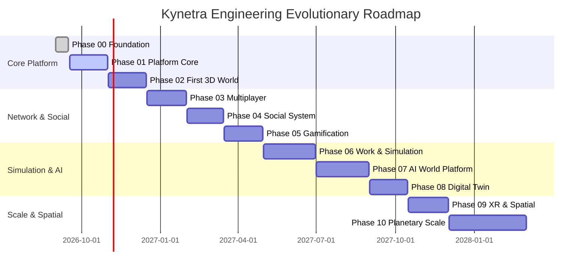

# Kynetra Roadmap Overview

This document provides a concise roadmap overview. For detailed capability breakdowns, non-goals, and exit criteria, see the phase specifications in [`docs/09-phases/`](./docs/09-phases/).

